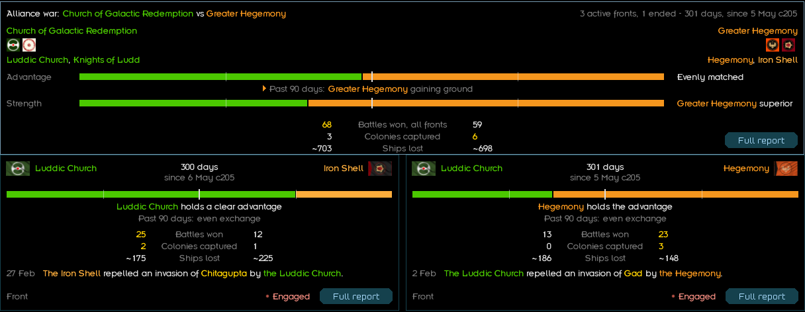
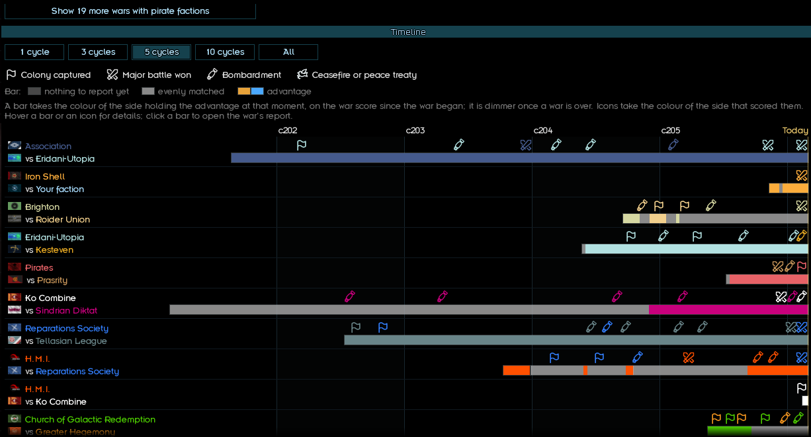
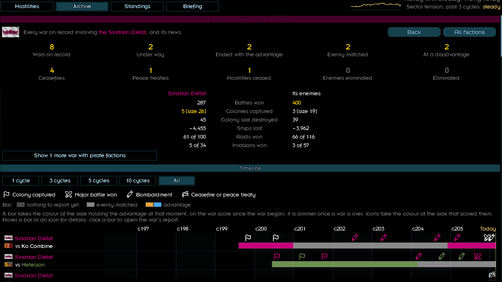

# War Room

A Starsector mod that tracks every war in the Sector. It adds one entry to the Intel screen.

**Needs:** Starsector 0.98a · Nexerelin · LazyLib

**What you get**
- **Hostilities**: every active war. Who leads, who is gaining, battles, captured colonies, ships lost.
- **War reports**: one per war. Event log, turning points, battle locations, strength comparison.
- **Archive**: timeline of all wars, plus a log of every event and Sector news.
- **Faction pages**: one faction's or alliance's wars and record. Click any flag or name.
- **Standings**: factions and alliances ranked by colonies, territory won and lost, and wars.
- **Briefing**: how war weariness, peace, alliances and the war score work.

<b>Screenshots</b>

**Extra info**
- Records start at install. For the full history, start a new save.
- Safe to add to or remove from a running save. Removing it deletes its records.
- Pirate wars stay hidden unless you are in them. One click shows them.
- Distant fights are estimates, marked "~".
- Settings live in `data/config/settings.json`: war score weights, time window, visual extras.

**Install:** unzip into `Starsector/mods`, then enable it in the launcher.

**License:** MIT. Credits: Histidine (Nexerelin), LazyWizard (LazyLib); some icons based on Tabler Icons
(MIT, see `graphics/warroom/icons`).
